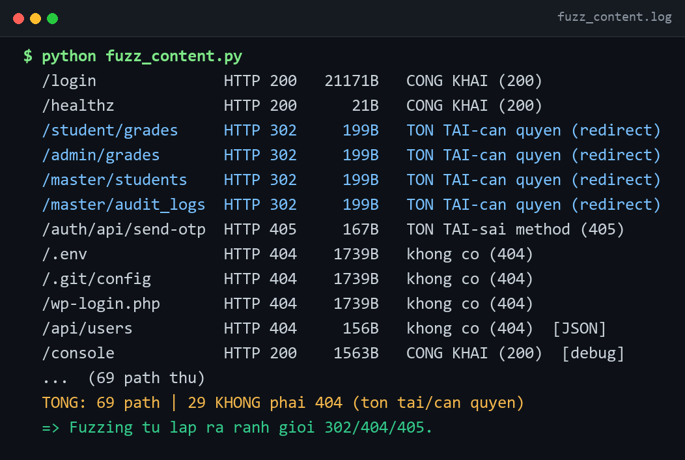
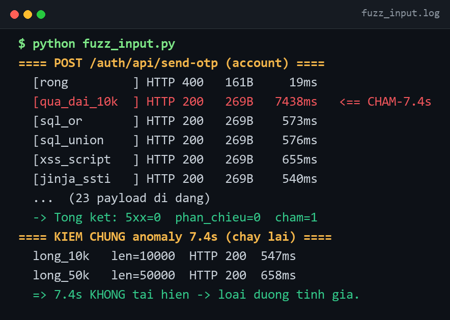
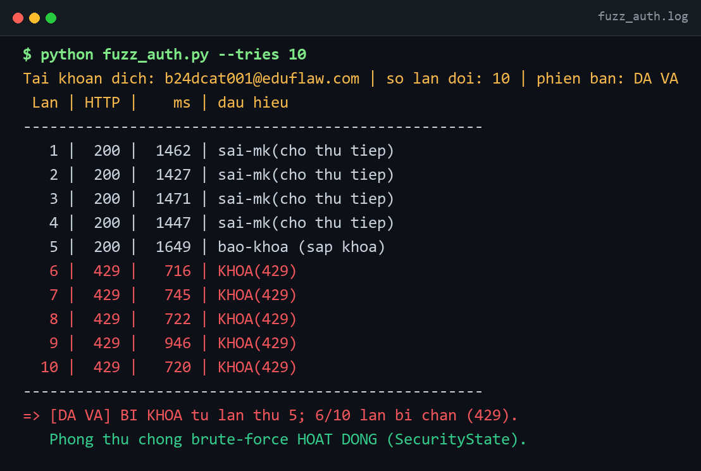
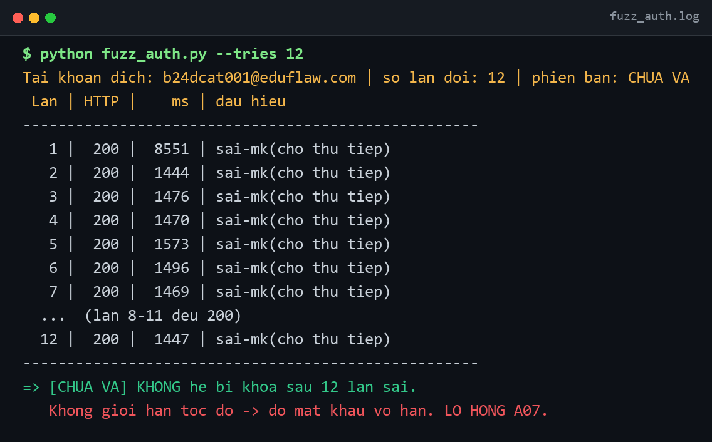
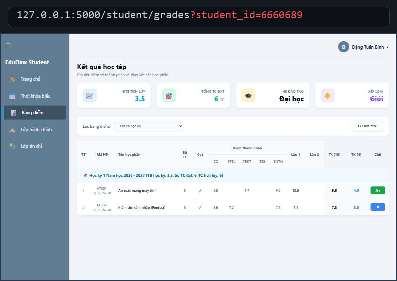
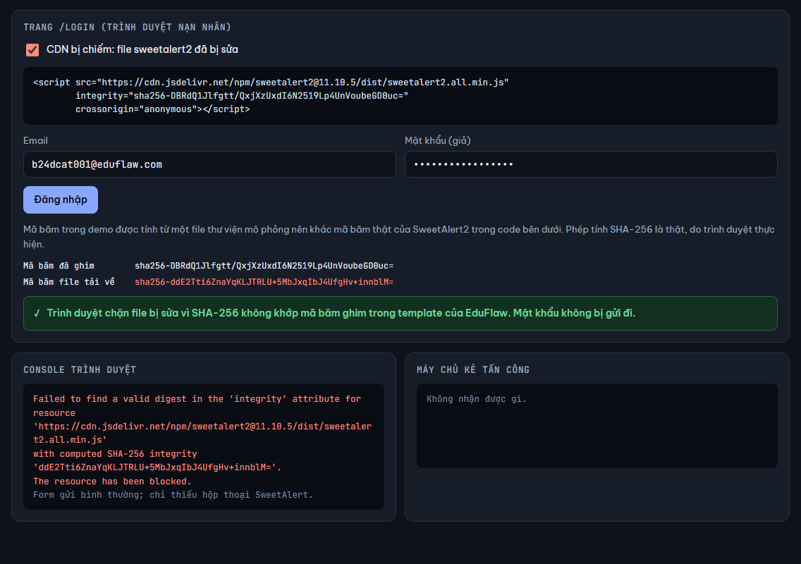
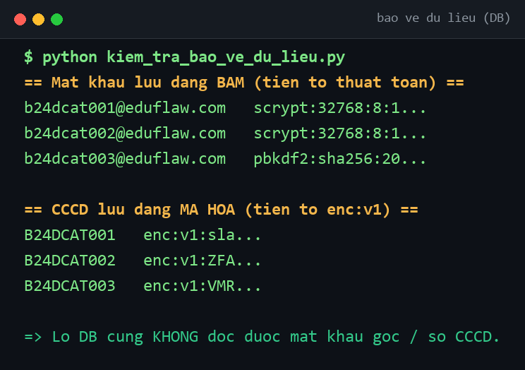
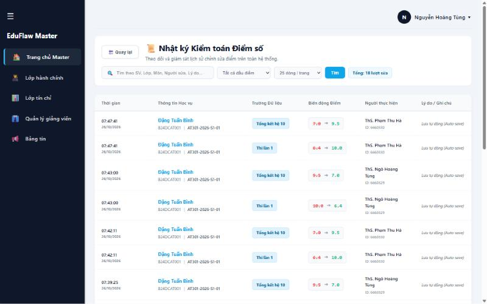

# 🎓 EduFlaw — Hệ thống Quản lý Đào tạo & Thực nghiệm Bảo mật Web

> **Bài tập lớn học phần:** Cơ sở An toàn thông tin  
> **Cơ sở đào tạo:** Học viện Công nghệ Bưu chính Viễn thông (PTIT Hà Nội)  
> **Giảng viên hướng dẫn:** ThS. Đỗ Xuân Chợ  
> **Nhóm thực hiện:** Nhóm 7 — Lớp D24CQCE04-B  
> **Chuẩn đánh giá:** OWASP Top 10:2025  

---

## 👥 Danh sách thành viên (Nhóm 7)

| STT | Họ và tên | Mã sinh viên | Vai trò & Phân công nhiệm vụ |
|:---:|---|:---:|---|
| 1 | **Nguyễn Hoàng Tùng** | `B24DCCE284` | **Trưởng nhóm** — Kiến trúc hệ thống, kiểm soát truy cập (A01) & tổng hợp |
| 2 | **Nguyễn Bá Minh Đức** | `B24DCCE053` | Kiểm thử xâm nhập, viết kịch bản khai thác PoC |
| 3 | **Trần Anh Tú** | `B24DCCE277` | Fuzzing đường dẫn & tham số, thu thập dữ liệu bằng chứng thực nghiệm |
| 4 | **Bùi Minh Khang** | `B24DCCE137` | Triển khai các lớp phòng thủ từ gốc, cấu hình bảo mật & kiểm thử hồi quy |

---

## 🎯 Mục đích dự án

EduFlaw được xây dựng nhằm đáp ứng **hai mục tiêu song hành**:

1. **Sản phẩm nghiệp vụ đào tạo thực tế:**  
   Ứng dụng web quản lý đào tạo đại học hoàn chỉnh viết bằng **Python (Flask) + MySQL**, phục vụ 3 vai trò:
   - **Master (Phòng Đào tạo):** Quản lý toàn diện ngành, sinh viên, giảng viên, lớp tín chỉ, nhật ký kiểm toán sửa điểm.
   - **Admin (Giảng viên / Cố vấn):** Nhập/sửa điểm các lớp phụ trách, theo dõi sinh viên lớp cố vấn.
   - **Student (Sinh viên):** Tra cứu bảng điểm chi tiết, GPA hệ 4/10, thời khóa biểu và hồ sơ cá nhân.

2. **Môi trường thực nghiệm an toàn thông tin:**  
   Thực hiện phương pháp tiếp cận **"Tự xây — Tự phá — Tự vá"** theo chuẩn bảo mật **OWASP Top 10:2025**, tập trung vào 4 nhóm trọng tâm:
   - **A01:2025** — Broken Access Control (Kiểm soát truy cập, IDOR, vượt quyền).
   - **A03:2025** — Software Supply Chain Failures (Bảo vệ chuỗi cung ứng, ghim phiên bản & SRI Integrity).
   - **A07:2025** — Authentication Failures (Chống brute-force, chống dò quét OTP, thu hồi phiên).
   - **A10:2025** — Mishandling of Exceptional Conditions (Xử lý ngoại lệ Fail-Closed, không lộ thông tin nhạy cảm).

---

## 📸 Bằng chứng kiểm thử & Thực nghiệm của nhóm

Nhóm đã tiến hành kiểm thử toàn diện trên hệ thống bằng cả hai phương pháp **Kiểm thử thủ công** và **Kiểm thử tự động (Fuzzing / Pentest Scripts)**:

### 1. Bằng chứng Fuzzing thực nghiệm (Slide 11 & Slide 12)

| Dò 69 đường dẫn (`fuzz_content.py`) | Bơm 23 payload dị dạng (`fuzz_input.py`) |
|:---:|:---:|
|  |  |
| *Quét không gian URL: Lập bản đồ ranh giới xác thực, phát hiện lộ `/console`* | *23 payload tấn công: **0 lỗi 5xx**, hệ thống xử lý ngoại lệ an toàn Fail-Closed* |

| Dội đăng nhập bản ĐÃ VÁ (`main`) | Dội đăng nhập bản CHƯA VÁ (Lỗ hổng A07) |
|:---:|:---:|
|  |  |
| *Khóa IP và tài khoản (HTTP 429) ngay sau lần thử sai thứ 5* | *Không giới hạn tốc độ, thử 12 lần liên tiếp không bị khóa* |

---

### 2. Bằng chứng phòng thủ lỗ hổng & Kiểm soát dữ liệu

| Phòng thủ IDOR (A01) | Bảo vệ chuỗi cung ứng SRI (A03) |
|:---:|:---:|
|  |  |
| *Sửa `?student_id` trên URL vẫn chỉ trả về dữ liệu của chính mình* | *CDN bị can thiệp -> Mã băm SHA-256 không khớp, trình duyệt chặn thực thi* |

| Dữ liệu mã hóa trong CSDL (Slide 57) | Nhật ký kiểm toán thay đổi điểm (Audit Logs) |
|:---:|:---:|
|  |  |
| *Mật khẩu băm an toàn, CCCD mã hóa AES-256-GCM (`enc:v1:...`)* | *Lưu vết mọi thay đổi điểm: Ai sửa, môn nào, điểm cũ -> mới* |

👉 *Xem toàn bộ 19 ảnh và phân tích chi tiết tại:* **[Báo cáo tổng hợp bằng chứng thực nghiệm](docs/BANG-CHUNG-KIEM-THU.md)**

---

## 🧪 Trang Demo mô phỏng lỗ hổng (Interactive Demo)

Để phục vụ trình bày trực quan tại buổi báo cáo, nhóm đã xây dựng trang web mô phỏng tương tác có công tắc chuyển đổi **"Có lỗ hổng" (Vulnerable)** ↔ **"Đã vá" (Secured)** cho 4 kịch bản OWASP 2025:
- **A01:** IDOR xem điểm người khác qua link URL.
- **A03:** CDN SweetAlert2 bị đầu độc, kiểm tra cơ chế SRI.
- **A07:** Tấn công dò mật khẩu và cơ chế khóa tài khoản.
- **A10:** Xử lý lỗi CSDL (Fail-Closed từ chối an toàn vs Fail-Open lộ quyền).

Mở trực tiếp trên trình duyệt: [`demo/index.html`](demo/index.html) *(không cần cài đặt backend)*.

---

## 🚀 Hướng dẫn chạy thử nghiệm

### Cách 1: Khởi chạy nhanh bằng Docker (Khuyến nghị)
Yêu cầu đã cài đặt [Docker Desktop](https://www.docker.com/products/docker-desktop/):

```bash
# 1. Clone mã nguồn
git clone https://github.com/Luffyreals/EduFlaw-CSATTT.git
cd EduFlaw-CSATTT

# 2. Khởi chạy toàn bộ hệ thống (Web + Database)
docker compose up
```

Truy cập: **http://localhost:8000**  
Đăng nhập tài khoản Master: `master@eduflaw.com` / `MasterEduFlaw@123` *(Hệ thống tự động nạp sẵn dữ liệu mẫu 3.000 sinh viên, giảng viên và lớp tín chỉ)*. Dừng dịch vụ: `docker compose down`.

### Cách 2: Chạy trực tiếp bằng Python
Yêu cầu **Python ≥ 3.11** và **MySQL**:
- **Windows:** Vào thư mục `src/`, chạy `powershell -ExecutionPolicy Bypass -File .\setup.ps1`, sau đó `python run.py`.
- **macOS / Linux:** Vào thư mục `src/`, chạy `./setup.sh`, sau đó `python run.py`.
- Chi tiết cấu hình tham khảo: [docs/DEPLOY.md](docs/DEPLOY.md).

---

## 📚 Tài liệu báo cáo & Thuyết trình của nhóm

- **Báo cáo toàn văn BTL:** [`BAO-CAO-DAY-DU.md`](BAO-CAO-DAY-DU.md)
- **Bộ công cụ Pentest & Fuzzing:** [`pentest/README.md`](pentest/README.md)
