# 📸 TỔNG HỢP BẰNG CHỨNG THỰC NGHIỆM & KIỂM THỬ BẢO MẬT (EDUFLAW)

Tài liệu này tổng hợp toàn bộ hình ảnh minh chứng, nhật ký thực thi (log files) và kết quả kiểm thử thực tế do nhóm thực hiện trên hệ thống **EduFlaw**, bám sát theo chuẩn **OWASP Top 10:2025** và nội dung báo cáo thuyết trình.

---

## 📑 MỤC LỤC BẰNG CHỨNG

1. [Giao diện hệ thống & Luồng người dùng](#1-giao-diện-hệ-thống--luồng-người-dùng)
2. [Bằng chứng Fuzzing & Rà quét tự động (Slide 11 & Slide 12)](#2-bằng-chứng-fuzzing--rà-quét-tự-động)
3. [Bằng chứng Tấn công & Phòng thủ theo 4 nhóm OWASP 2025](#3-bằng-chứng-tấn-công--phòng-thủ-theo-4-nhóm-owasp-2025)
   - [A01: Broken Access Control (IDOR & Phân quyền)](#31-a012025--broken-access-control)
   - [A03: Software Supply Chain Failures (SRI & CDN)](#32-a032025--software-supply-chain-failures)
   - [A07: Authentication Failures (Brute-force & Khóa tài khoản)](#33-a072025--authentication-failures)
   - [A10: Mishandling of Exceptional Conditions (Fail-Closed & Lỗi)](#34-a102025--mishandling-of-exceptional-conditions)
4. [Bằng chứng Bảo vệ dữ liệu tầng CSDL & Nhật ký kiểm toán](#4-bằng-chứng-bảo-vệ-dữ-liệu-tầng-csdl--nhật-ký-kiểm-toán)

---

## 1. Giao diện hệ thống & Luồng người dùng

### 1.1. Cổng đăng nhập an toàn & Cơ chế OTP
- Hệ thống hỗ trợ đăng nhập bằng Email hoặc Mã sinh viên/cán bộ.
- Bảo vệ chống CSRF tự động trên mọi form, cookie phiên gắn cờ `HttpOnly`, `SameSite=Lax`.
- Khôi phục mật khẩu xác thực đa bước qua mã OTP gửi về Gmail liên kết, giới hạn tần suất gửi (Rate-limiting).

| Cổng đăng nhập EduFlaw Portal | Xác thực khôi phục mật khẩu OTP |
|:---:|:---:|
| 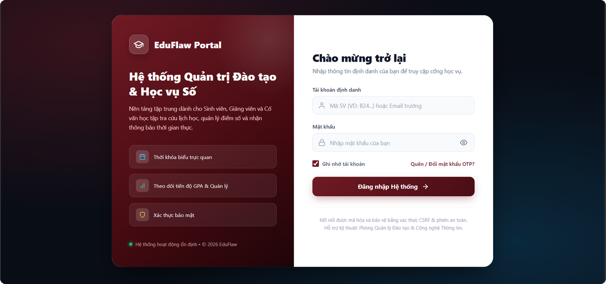 | 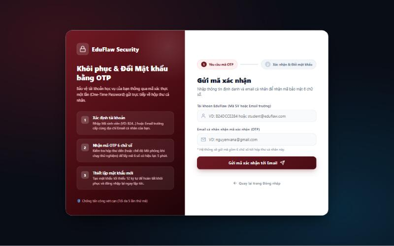 |

---

### 1.2. Phân hệ Sinh viên (Student Role)
- Sinh viên theo dõi tiến độ đào tạo, GPA tích lũy hệ 4/10, bảng điểm chi tiết các thành phần (CC, BTTL, TBKT, TGK, TNTH, Thi).
- Chỉ xem được thời khóa biểu và hồ sơ của chính mình.

| Trang chủ Sinh viên (GPA & Tiến độ) | Bảng điểm chi tiết từng môn |
|:---:|:---:|
| 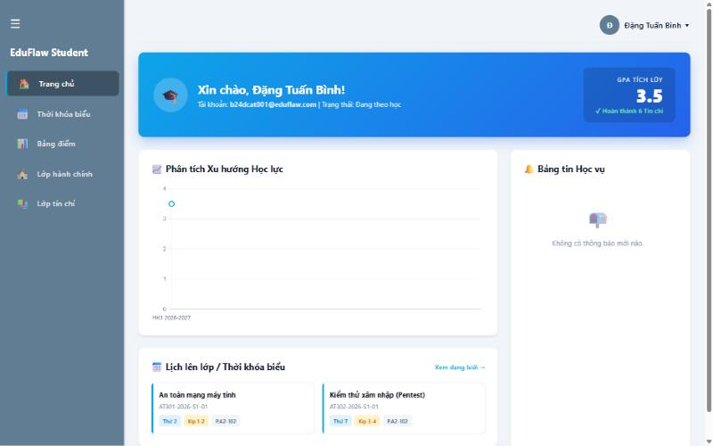 | 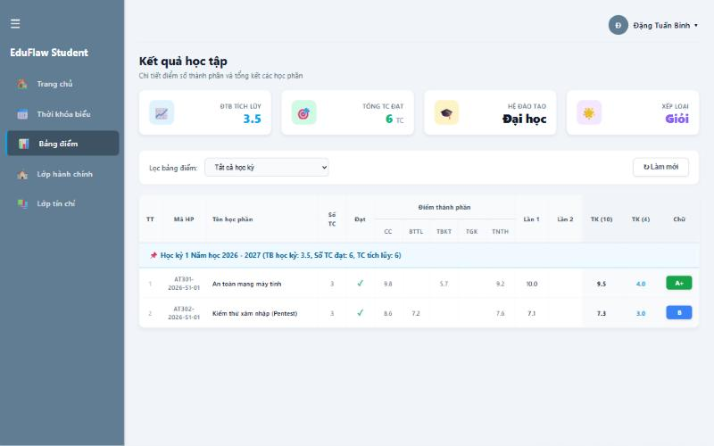 |

*Thời khóa biểu tuần của Sinh viên:*
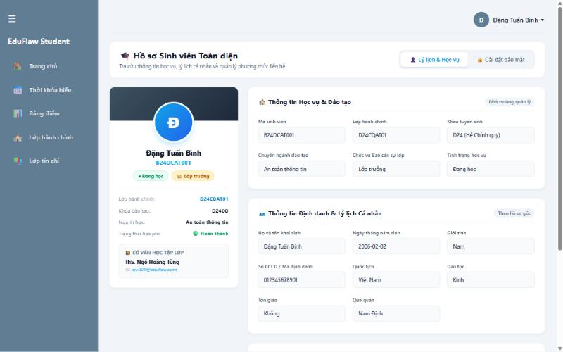

---

### 1.3. Phân hệ Quản trị viên (Master Role)
- Quản lý toàn trường: danh sách sinh viên, ngành học, giảng viên, lớp tín chỉ và biểu đồ phân bổ điểm.
- Hỗ trợ phân trang và tìm kiếm phía server (Server-side Pagination) để xử lý dữ liệu lớn.

| Bảng điều khiển Master (Thống kê & Phổ điểm) | Quản lý sinh viên & Ngành đào tạo |
|:---:|:---:|
| 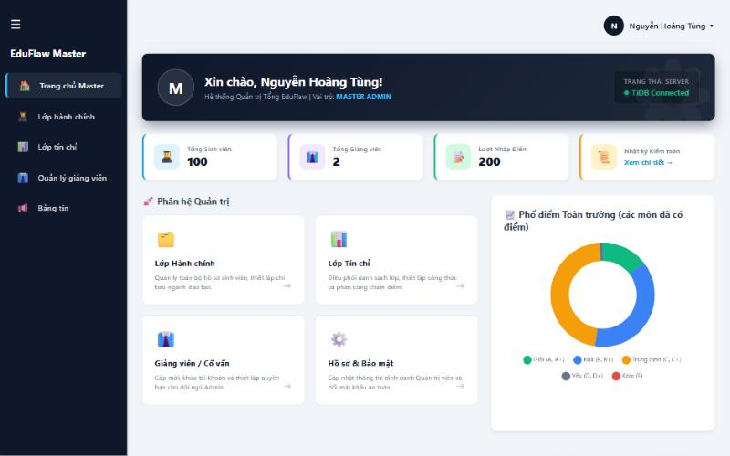 | 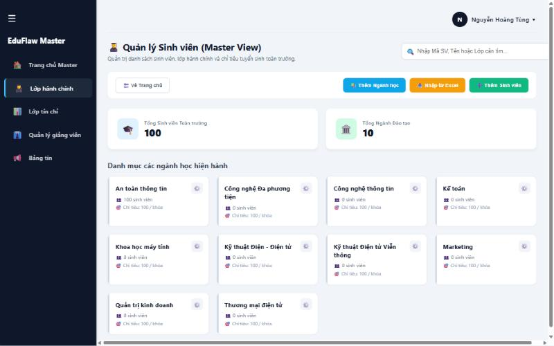 |

---

## 2. Bằng chứng Fuzzing & Rà quét tự động

### 2.1. Fuzzing không gian đường dẫn (`fuzz_content.py` — Slide 11)
- **Số lượng đã dò:** 69 đường dẫn phổ biến.
- **Kết quả:** Phát hiện 29 route phản hồi khác 404 (các route được bảo vệ trả về `HTTP 302` chuyển hướng về `/login`, route chỉ nhận POST trả về `HTTP 405`).
- **Phát hiện:** Khi bật chế độ debug, route `/console` của Werkzeug bị lộ (HTTP 200). Hệ thống đã vá bằng cách tắt Debug trên môi trường Production.

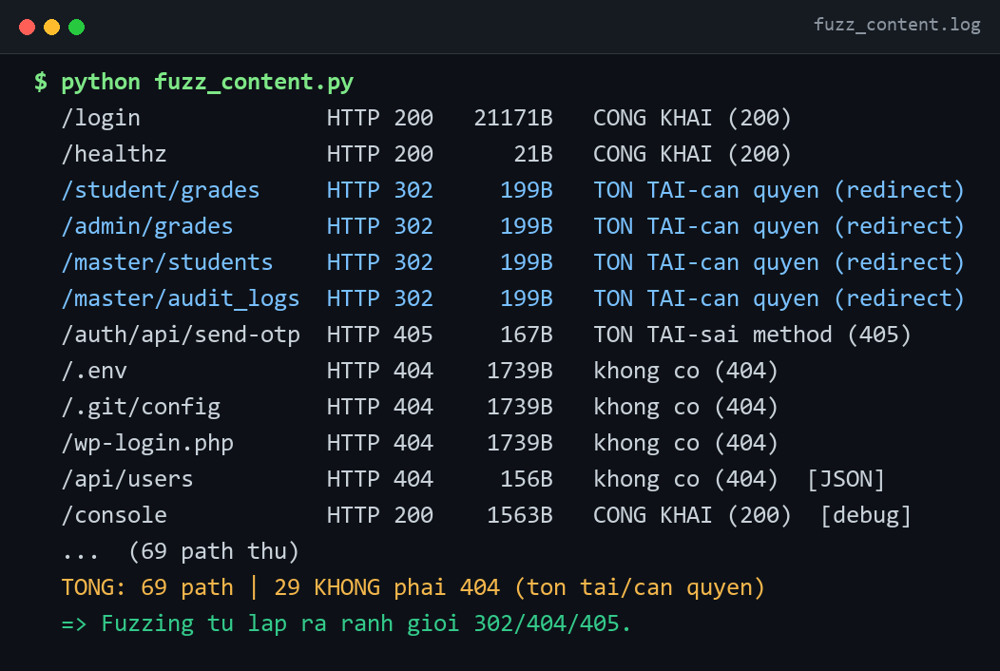
*(Nhật ký chi tiết xem tại: [`pentest/evidence/fuzzing/fuzz_content.log`](../pentest/evidence/fuzzing/fuzz_content.log))*

---

### 2.2. Fuzzing tham số đầu vào dị dạng (`fuzz_input.py` — Slide 11)
- **Số lượng payload:** 23 payload tấn công kinh điển (SQL Injection, XSS, Path Traversal, Null Byte, CRLF, SSTI, chuỗi cực lớn 10k/50k ký tự).
- **Kết quả:** **0 lỗi 5xx**. Hệ thống bắt và xử lý toàn bộ ngoại lệ an toàn, trả về HTTP 400 hoặc xử lý logic bình thường mà không làm sập tiến trình máy chủ.

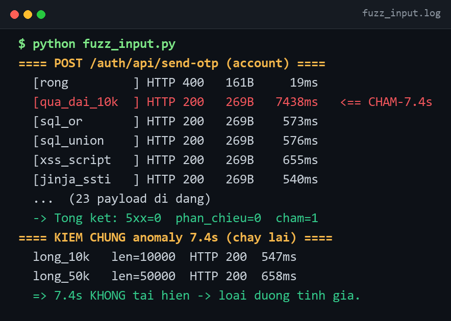
*(Nhật ký chi tiết xem tại: [`pentest/evidence/fuzzing/fuzz_input.log`](../pentest/evidence/fuzzing/fuzz_input.log))*

---

### 2.3. Dội thử mật khẩu: Trước và Sau khi vá (`fuzz_auth.py` — Slide 12)

| Phiên bản ĐÃ VÁ (Main — Chống Brute-force) | Phiên bản CHƯA VÁ (Lỗ hổng A07) |
|:---:|:---:|
| 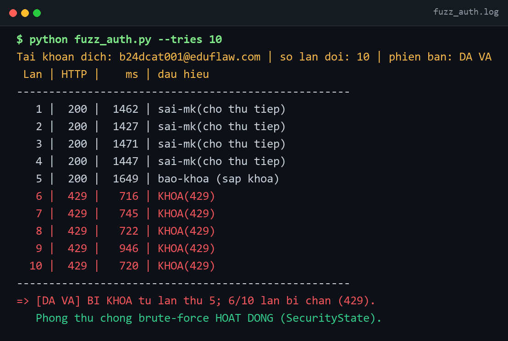 | 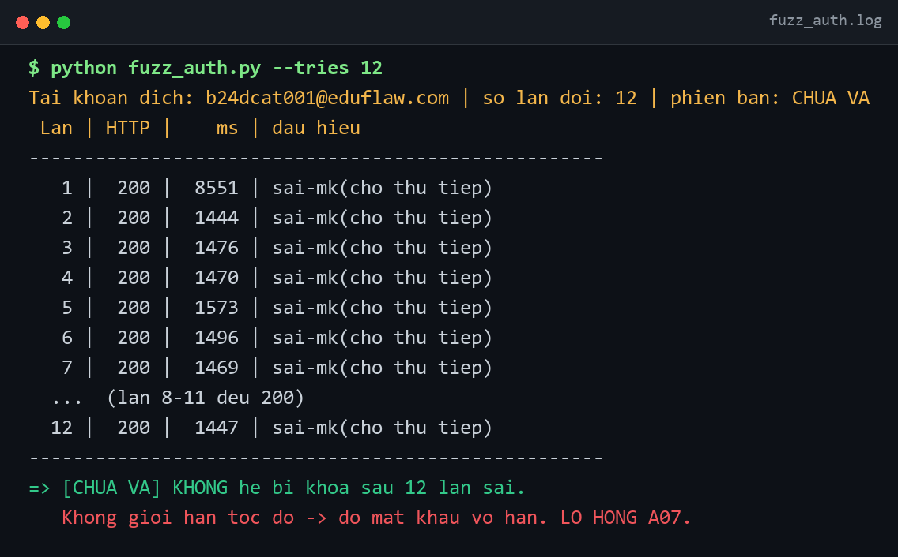 |
| Sau 5 lần nhập sai, IP và tài khoản bị khóa trong 60 giây (**HTTP 429 Too Many Requests**). | Không có ngưỡng khóa, kẻ tấn công có thể dội mật khẩu vô hạn lần. |

*(Xem nhật ký đối chứng tại [`pentest/evidence/fuzzing/fuzz_auth_main.log`](../pentest/evidence/fuzzing/fuzz_auth_main.log) và [`fuzz_auth_vuln_A07-1.log`](../pentest/evidence/fuzzing/fuzz_auth_vuln_A07-1.log))*

---

## 3. Bằng chứng Tấn công & Phòng thủ theo 4 nhóm OWASP 2025

### 3.1. A01:2025 — Broken Access Control
- **Lỗ hổng:** Trang xem điểm nhận `student_id` qua URL query param (`?student_id=6660689`), cho phép sinh viên thay đổi ID để xem điểm của sinh viên khác (IDOR).
- **Phòng thủ:** Loại bỏ hoàn toàn tham số `student_id` từ URL; định danh người dùng được trích xuất trực tiếp từ phiên xác thực an toàn ở máy chủ (`session['user_id']`). Dù kẻ tấn công có đổi tham số trên URL, hệ thống vẫn chỉ trả dữ liệu của chính tài khoản đó.

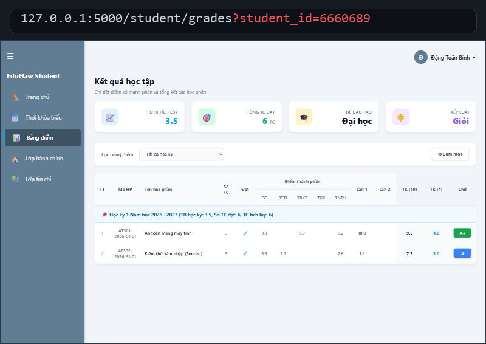

---

### 3.2. A03:2025 — Software Supply Chain Failures
- **Lỗ hổng:** Ứng dụng nhúng thư viện JavaScript bên thứ ba từ CDN mà không có kiểm tra tính toàn vẹn (SRI). Nếu máy chủ CDN bị xâm phạm hoặc file bị chèn mã độc, script độc hại sẽ đánh cắp mật khẩu đăng nhập của người dùng.
- **Phòng thủ:** Ghim phiên bản chính xác và bổ sung mã băm **SRI (Subresource Integrity)** `integrity="sha256-..."` cùng `crossorigin="anonymous"`. Khi file bị thay đổi dù chỉ 1 byte, trình duyệt sẽ tự động từ chối nạp file.

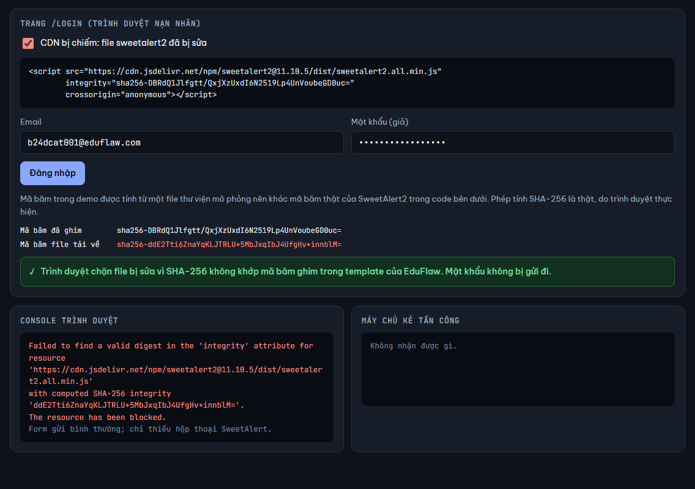

---

### 3.3. A07:2025 — Authentication Failures
- **Lỗ hổng:** Không giới hạn số lần thử đăng nhập sai; không vô hiệu hóa phiên cũ khi người dùng đổi mật khẩu.
- **Phòng thủ:** 
  1. Quản lý trạng thái đăng nhập tập trung trong CSDL (`login_attempts`), khóa IP và tài khoản sau 5 lần sai.
  2. Gắn dấu vân tay mật khẩu (`password_fingerprint` — HMAC băm mật khẩu). Khi tài khoản đổi mật khẩu hoặc reset, toàn bộ các phiên cũ trên các trình duyệt khác sẽ lập tức bị hủy bỏ và chuyển hướng về `/login`.

---

### 3.4. A10:2025 — Mishandling of Exceptional Conditions
- **Lỗ hổng:** Khi CSDL gặp sự cố ngắt kết nối hoặc quá tải, hàm kiểm tra phiên bị rơi vào trạng thái Fail-Open (trả về `True`), cho phép kẻ tấn công sở hữu cookie cũ vẫn lọt qua rào kiểm soát quyền. Đồng thời, lỗi không được bọc khiến trang lộ chi tiết Stack Trace và câu lệnh SQL nội bộ.
- **Phòng thủ:** 
  1. Áp dụng triệt để nguyên tắc **Fail-Closed**: Mọi sự cố bất thường ở tầng dữ liệu đều mặc định từ chối truy cập và hủy phiên.
  2. Đăng ký trang lỗi an toàn tiếng Việt, không để lộ bất kỳ thông tin nhạy cảm nào ra phía người dùng; chi tiết kỹ thuật chỉ được ghi vào log máy chủ.

| Trang thông báo lỗi 500 an toàn | Demo đối chứng Fail-Closed vs Fail-Open |
|:---:|:---:|
| 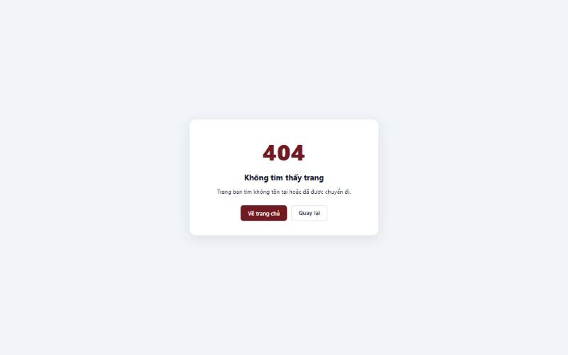 | 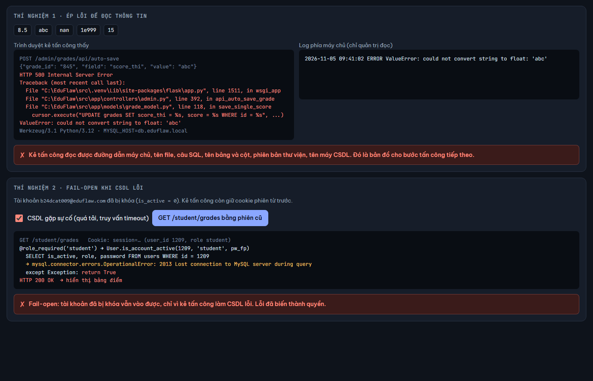 |

---

## 4. Bằng chứng Bảo vệ dữ liệu tầng CSDL & Nhật ký kiểm toán

### 4.1. Mã hóa dữ liệu nhạy cảm & Băm mật khẩu (Slide 57)
- **Mật khẩu:** Băm một chiều bằng chuẩn công nghiệp (Scrypt / PBKDF2 của Werkzeug).
- **Căn cước công dân (CCCD):** Mã hóa ở tầng ứng dụng bằng thuật toán **AES-256-GCM** với khóa riêng (`FIELD_ENCRYPTION_KEY`). Trong CSDL, cột `id_card` chỉ lưu chuỗi mã hóa có tiền tố `enc:v1:...`. Dù kẻ tấn công có chiếm được bản sao lưu CSDL (Dump DB), số CCCD vẫn hoàn toàn được bảo mật.

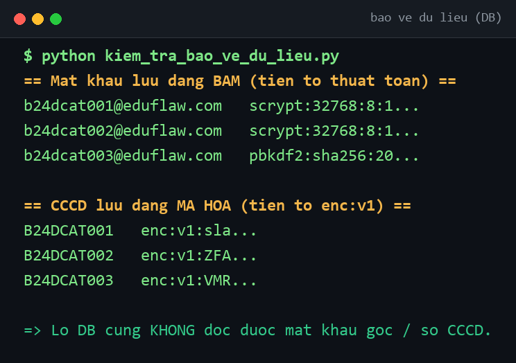

---

### 4.2. Nhật ký kiểm toán sửa điểm (Audit Logs — Slide 57)
- Mọi thao tác chỉnh sửa bất kỳ thành phần điểm nào (CC, BTTL, TBKT, TGK, TNTH, Thi) đều được hệ thống tự động lưu vết vào bảng `grade_audit_logs`.
- Ghi nhận chi tiết: **Thời gian thực hiện**, **Tài khoản người sửa**, **Lớp tín chỉ**, **Tên sinh viên**, **Môn học**, **Tên cột điểm**, **Điểm cũ** và **Điểm mới**.

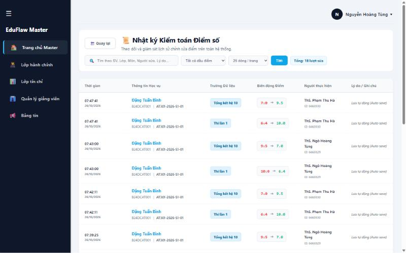

---

### 4.3. Kiểm thử Security Headers trên môi trường mạng (Slide 56)
- Đánh giá các tiêu chuẩn an toàn qua dòng lệnh (`a05_3_headers.py`):
  - `Content-Security-Policy`: Giới hạn nguồn tài nguyên nạp vào trang.
  - `X-Frame-Options: DENY`: Chống tấn công Clickjacking.
  - `X-Content-Type-Options: nosniff`: Chống MIME-sniffing.
  - `Strict-Transport-Security` (HSTS): Ép buộc kết nối mã hóa HTTPS.

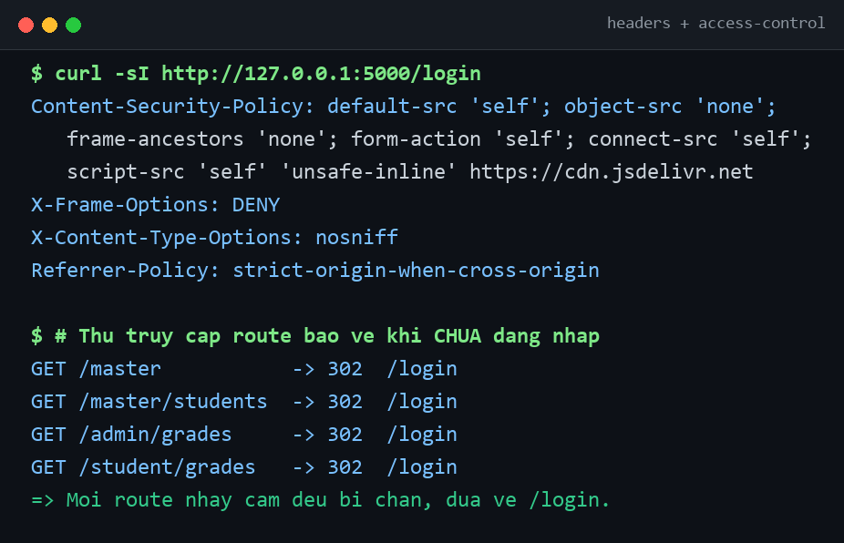
